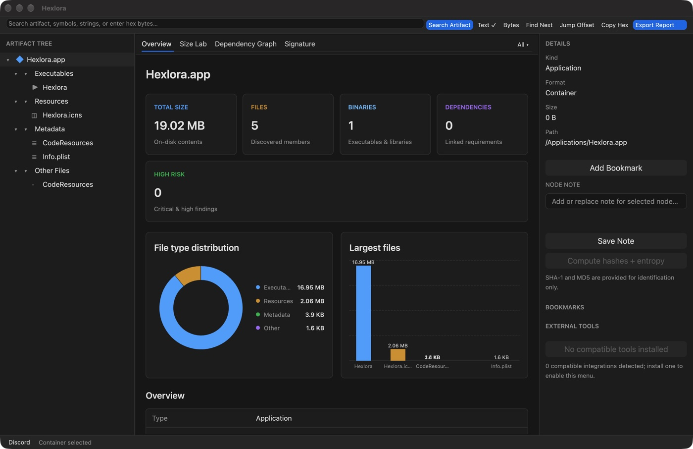
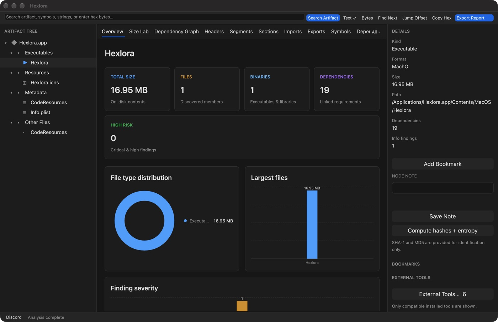
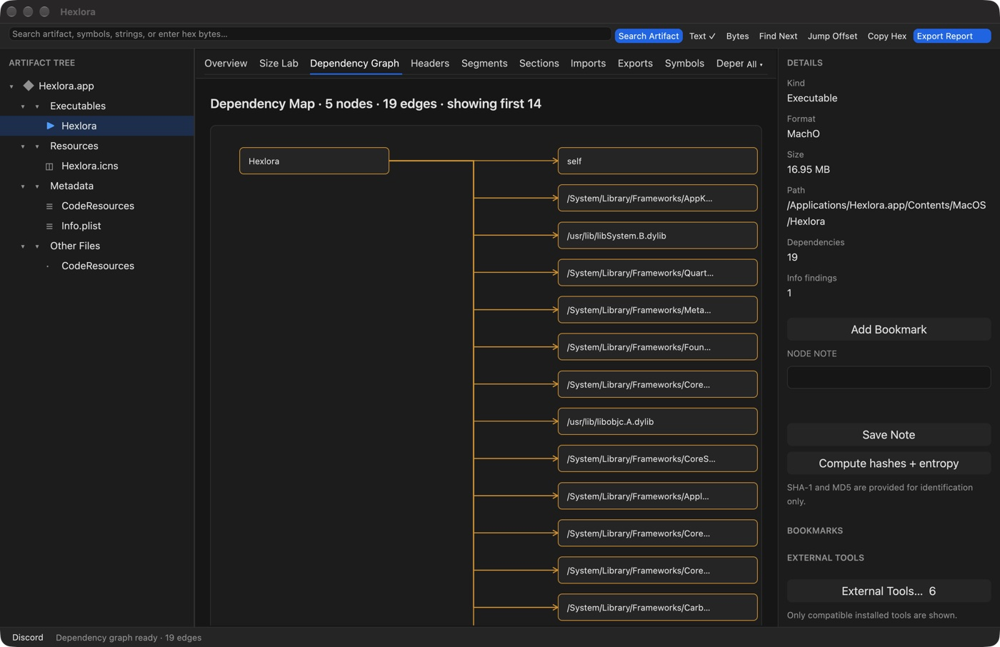
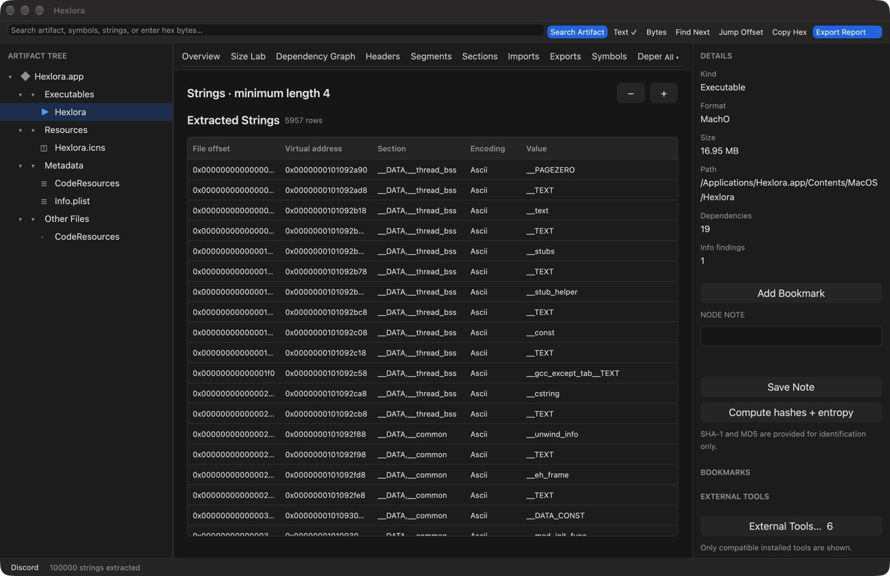
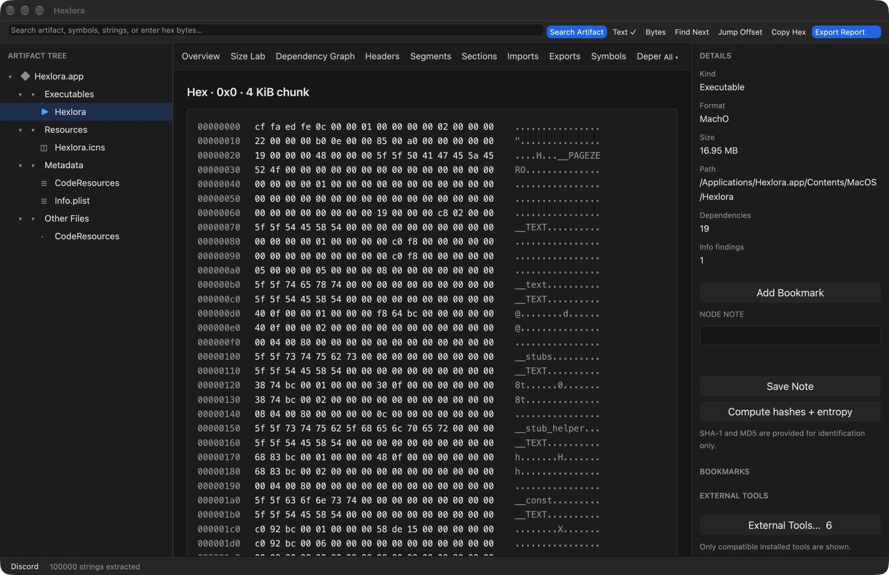

<div align="center">


# Hexlora

**A static inspection workbench for apps, packages, and binaries.**

Open an `.app`, IPA, APK, MSIX, DEB, PE, Mach-O, or ELF and see what is inside it — structure, dependencies, signatures, strings, capabilities, code, and release findings — without ever running it.

[](https://github.com/everettjf/hexlora/releases/latest)
[](#install)
[](LICENSE)
[](https://discord.gg/eGzEaP6TzR)

[Website](https://atomsprout.com/hexlora/) · [Install](#install) · [CLI](#command-line) · [Supported formats](#supported-formats) · [Discord](https://discord.gg/eGzEaP6TzR)

[](https://atomsprout.com/hexlora/#gallery)

</div>

## Why Hexlora

- **One model for every platform.** Applications, directories, packages, and single files all open as an *Artifact* with the same tree, views, and findings. PE, Mach-O, and ELF are analyzed on any host.
- **Triage before a disassembler.** Readable symbol names, inferred capabilities with their evidence, packing and kernel-driver traits, your own YARA rules, and a bounded disassembly preview that names call targets and strings — enough to decide what deserves a real reverse-engineering tool.
- **Release audits, not just parsing.** IPA, APK, APPX/MSIX, and DEB get platform-aware checks for identity, permissions, entitlements, privacy manifests, signing, and installation risk.
- **Safe by construction.** Hexlora is read-only and static. It never executes, installs, mounts, or extracts what you open, and every parser runs under explicit limits.
- **Built for large inputs.** Tables are virtualized, Hex reads 4 KiB windows on demand, and expensive work (hashes, entropy, strings, signature verification) runs only when you ask for it.
- **The same engine in CI.** `hexlora-cli` emits JSON, Markdown, HTML, or SARIF, enforces versioned release policies, and returns stable exit codes.

## Screenshots

| Executable details | Dependency resolution |
|---|---|
| [](docs/assets/screenshots/executable.jpg) | [](docs/assets/screenshots/dependencies.jpg) |
| **Extracted strings** | **Bounded hex inspection** |
| [](docs/assets/screenshots/strings.jpg) | [](docs/assets/screenshots/hex.jpg) |

More in the [gallery](https://atomsprout.com/hexlora/#gallery). All screenshots show Hexlora statically inspecting its own application bundle.

## Install

### macOS

Requires an Apple silicon Mac running macOS 13 Ventura or later.

```sh
brew install --cask everettjf/tap/hexlora
```

The app is Developer ID signed, notarized by Apple, and ships with a stapled ticket, so Gatekeeper can verify it offline.

### Windows and Linux

Download the package for your platform from the [latest release](https://github.com/everettjf/hexlora/releases/latest):

| Platform | Packages |
|---|---|
| Windows x64 | `.msi` installer, portable `.zip` |
| Linux amd64 | `.deb` package, portable `.tar.gz` |

These packages are not code-signed yet. Verify them against the `SHA256SUMS` file published with each release before installing.

### Command-line tool

```sh
brew install everettjf/tap/hexlora-cli
hexlora-cli --version
```

## Using the desktop app

Drag a file, folder, application, package, or workspace into the window — or use **File → Open File** (`⌘O`) for a single file or package and **File → Open Folder** (`⇧⌘O`) for a bundle or directory.

- **Artifact Tree** groups executables, frameworks, libraries, plug-ins, resources, and metadata logically rather than by path. Archive and package members appear as a virtual tree without extraction.
- **Inspector tabs** cover Overview, Headers, Slices, Sections, Segments, Imports, Exports, Symbols, Relocations, Dependencies, Dependency Graph, Strings, Hex, Disassembly, Capabilities, Entropy, Size Lab, Signature, Metadata, and Findings. IPA, APK, MSIX, and DEB packages add their own summary, component, signing, privacy, and findings tabs.
- **Tables** size their columns to the content. Click any row to read every value in full and copy it; when a table is wider than the panel it scrolls sideways, and **More columns →** jumps to the columns past the edge.
- **Disassembly** lists the functions Hexlora can find in a PE, ELF, or Mach-O binary (x86, x86-64, arm64) and shows a linear listing with call targets, imports, and referenced strings named. Click a function to list it, click a line to follow its target or see its bytes in Hex, and use **Disassemble** on a Symbols or Exports row to jump straight there. A PDB, dSYM, or `.debug` file next to the binary is picked up automatically when it matches; **Load Symbols…** chooses another. Nothing is downloaded.
- **Capabilities** shows what a binary appears able to do — inject into other processes, persist, capture input, talk to the network, map physical memory from a driver — with the imports and strings behind each inference and a confidence. It is evidence for review, not a verdict.
- **File → Scan with YARA Rules** (`⇧⌘Y`) runs a rule file you choose — or **Scan with YARA Rule Folder** a whole folder of them — against every file in the artifact, archive members included, and lists the matches in a YARA tab. Launching with `Hexlora <artifact> --yara <rules>` runs the scan as soon as the artifact opens.
- **Search** (`⌘F`) spans names, metadata, symbols, and strings across the whole artifact, and accepts hexadecimal byte queries.
- **File → Compare Artifacts** (`⇧⌘C`) diffs two artifacts by exact content identity: added, removed, modified, and moved files, size growth by directory and type, duplicates, and IPA privacy, signing, and entitlement changes.
- **Release Policy** (`⌥⌘P`) applies the same versioned policy file the CLI uses and lists violations in the Policy tab.
- **Reports** — **File → Export Markdown Report**, **Export PDF Report**, and **Export Visual Report** (an SVG dashboard) write to a location you choose. Nothing is uploaded.
- **Workspaces** (`⌘S` to save, `⌥⌘O` to open) keep the artifact path, selected view, bookmarks, notes, and cached results.
- **External Tools** lists compatible tools installed on your machine and launches them only when you ask. Launched from the Disassembly tab, a tool is handed the address you are reading: radare2 opens at it, IDA jumps to it once its analysis finishes, and objdump disassembles just that code. Tools that take no address on their command line, such as Ghidra, Binary Ninja, and Hopper, are opened on the file with the address copied to the clipboard for their go-to-address command.

Three layout presets — **Standard**, **Focus**, and **Analysis** — are in the View menu along with a high-contrast mode. `⌘N` opens an independent window. The interface is English-only.

## Command line

`hexlora-cli` is a separate executable. It writes a versioned report to stdout and diagnostics to stderr, so it is safe to pipe.

```sh
# Structural report as pretty JSON
hexlora-cli inspect ./SomeApp.app --pretty

# Everything: hashes, strings, entropy, signatures, dependency graph
hexlora-cli inspect ./app.exe --depth deep --output report.json

# Pick individual tasks
hexlora-cli inspect ./package --hash sha256 --strings --entropy

# Compare two builds and fail if the installed size grew by more than 5 MiB
hexlora-cli compare old.ipa new.ipa --max-growth-bytes 5242880

# Scan with your own YARA rules and fail on a high-severity match
hexlora-cli inspect ./package --yara ./rules --fail-on high

# Disassemble from the entry point, or from an address or function
hexlora-cli disasm ./app.exe
hexlora-cli disasm ./app.exe --at 0x140001060 --at DllMain --count 400
```

| Option | Purpose |
|---|---|
| `--depth lightweight\|standard\|deep` | `standard` (default) is structural analysis. `deep` adds SHA-256, strings, entropy, signature inspection, and the dependency graph. |
| `--format json\|markdown\|html\|sarif` | Report format. JSON is the stable default. |
| `--hash`, `--strings`, `--entropy`, `--signature`, `--dependencies` | Enable individual expensive tasks. |
| `--capabilities` | Search each binary for the strings capability rules look for. Without it (and below `deep`) capabilities are inferred from imports alone. |
| `--functions` | List the functions found in each binary, with debug symbols when they are embedded or sit beside it. |
| `--yara <rules>` | Scan every file with the YARA rules in a file or directory. Matches become findings. |
| `--fail-on <severity>` | Exit `2` when a finding of this severity or higher is present. |
| `--policy <file>` | Enforce a versioned JSON release policy. |
| `--output <file>` | Write the report to a file, atomically. |

Run `hexlora-cli inspect --help`, `hexlora-cli compare --help`, or `hexlora-cli disasm --help` for the full list.

### Disassembly

`hexlora-cli disasm` prints a listing as text, or as JSON with `--json`. It reads the file's bytes and never loads or runs it.

```text
$ hexlora-cli disasm ./app.exe --at inject --count 6
; ./app.exe
; x86_64 · image base 0x140000000 · 12 functions known
; PDB symbols from ./app.pdb · 12 functions · 21 line records

inject:
  ; C:\src\app.c:66
  0x140001060  56                        push rsi
  0x140001061  57                        push rdi
  0x140001062  4883ec38                  sub rsp, 0x38
  0x140001066  4189c8                    mov r8d, ecx
  ; C:\src\app.c:67
  0x140001069  b9ffff1f00                mov ecx, 0x1fffff
  0x14000106e  31d2                      xor edx, edx
  ; instruction limit reached; more follows
```

| Option | Purpose |
|---|---|
| `--at <target>` | Where to start: `entry` (the default), a hexadecimal address, or a function name. Repeatable. |
| `--functions` | List the discovered functions instead of disassembling. |
| `--count <n>` | Most instructions per listing (default 200). |
| `--file <name>` | Pick the binary inside an application, package, or directory. |
| `--slice <arch>` | Pick a slice of a universal Mach-O, by name (`arm64`) or index. |
| `--symbols <file>` | Use this PDB, dSYM, or debug file. It must match the binary. |

Function starts come from what the file states about itself: its entry point, exports, symbol tables, unwind data, and import stubs, plus debug symbols when present. The listing is linear. Hexlora does not follow indirect jumps, rebuild control-flow graphs, or decompile; hand off to a dedicated tool for that.

### Release policies in CI

Policies apply to IPA, APK, APPX/MSIX, DEB, generic artifacts, and comparisons. They support built-in profiles (`balanced`, `strict`, `store_release`), rule allow and deny lists, severity overrides, and documented suppressions with optional expiry dates. `forbidden_capabilities` fails the build when any binary has a listed capability, such as `injection.remote-thread` or the whole `injection.*` group.

```sh
hexlora-cli inspect MyApp.ipa --depth deep \
  --policy examples/policies/store-release.json \
  --format sarif --output hexlora.sarif
```

Start from the [store-release policy](examples/policies/store-release.json). The [GitHub Actions example](examples/github-actions/hexlora-audit.yml) shows policy enforcement, SARIF upload, and report retention. The JSON output is described in the [report schema](docs/report-schema.md).

### Exit codes

| Code | Meaning |
|---|---|
| `0` | Complete report |
| `1` | Fatal error |
| `2` | Policy violation, or `--fail-on` / growth threshold reached |
| `4` | Cancelled (Ctrl-C) |
| `5` | Usable but partial report |

## Supported formats

Hexlora distinguishes three levels of support:

- **Audit** — platform-aware release semantics and findings.
- **Inspect** — bounded structural parsing and navigation.
- **Identify** — reliable type recognition. Search, strings, hashes, entropy, and Hex still work.

### Applications and release packages

| Artifact | Level | What you get |
|---|---|---|
| iOS `.ipa` | Audit | App identity and versions, installed and compressed size, embedded apps, extensions and frameworks, architectures and simulator-slice checks, localizations, usage descriptions and privacy manifests, provisioning profile, entitlements, evidence-linked findings, IPAView-compatible JSON |
| Android `.apk` | Audit | Binary manifest parsing, package and SDK identity, permissions, exported components, intent filters and deep links, DEX counts, native libraries and ABIs, signing-scheme indicators, release findings |
| Windows `.appx` / `.msix` | Audit | Manifest identity, publisher, architecture, target device families, normal and restricted capabilities, entry points, block-map and signature presence, release findings |
| Debian `.deb` | Audit | Control metadata, dependencies, installed size, payload table, Unix modes and privileged-file checks, maintainer scripts, release findings |
| macOS `.app`, frameworks, bundles, directories | Inspect | Logical component tree, Info.plist metadata, Mach-O slices, dependencies, static and host-verified signatures, entitlements, Hardened Runtime, Gatekeeper and notarization assessment |
| Windows PE/COFF (`.exe`, `.dll`, `.sys`) | Inspect | Headers, sections, relocations, imports, exports, symbols, dependencies, entry point, image base, Authenticode metadata, import hash, Rich header, overlay and packing traits, kernel-driver identification, capabilities, disassembly (x86, x86-64, arm64), PDB symbols |
| Linux ELF executables and shared objects | Inspect | Headers, interpreter, sections, segments, relocations, dynamic imports and exports, symbols, dependencies, build metadata, capabilities, disassembly (x86, x86-64, arm64), DWARF symbols |
| Mach-O and Universal Mach-O | Inspect | Per-slice architecture, headers, load commands, sections, segments, relocations, imports, exports, symbols, dylib dependencies, code-signature blob, capabilities, disassembly (x86-64, arm64), dSYM symbols |
| Apple flat `.pkg` / `.mpkg` and XAR | Inspect | Table of contents, member sizes, checksums, embedded-signature count, unsafe-path indicators |

<details>
<summary><strong>Containers, disk images, and archives</strong></summary>

| Format | Level | What you get |
|---|---|---|
| ZIP | Inspect | Central-directory-only member tree, compressed and expanded sizes, CRC metadata, symlink detection, path-traversal hazards, expansion-ratio findings |
| Electron ASAR | Inspect | Virtual member tree, per-member bytes for Hex, strings, search and hashing, header metadata; unpacked members resolve to the sibling `.asar.unpacked` files |
| tar, tar.gz, tgz | Inspect | Bounded member table, sizes, modes, links, and path hazards |
| ar archives and static libraries | Inspect | Bounded member table and sizes |
| Apple UDIF/DMG | Inspect | Trailer and container metadata, partitions, sectors, compressed blocks, and compression ratios; recognized by structure, never mounted |
| ISO 9660 | Inspect | Volume descriptor, volume identifier, sector and block-size metadata; never mounted |
| 7z, RAR, standalone gzip/bzip2/xz/zstd | Identify | Type identification plus the universal file workflows; member browsing is not implemented yet |

</details>

<details>
<summary><strong>Resources, media, and data files</strong></summary>

| Format | Level | What you get |
|---|---|---|
| JSON, XML, XML/binary plist | Inspect | Bounded structured parsing and flattened metadata |
| SQLite 3 | Inspect | Header, page size, read/write versions, schema format, text encoding |
| Apple Compiled Asset Catalog (`.car`) | Inspect | BOM header metadata and named section keys; renditions are not extracted |
| Apple ICNS | Inspect | Declared size and a bounded chunk table of icon types and sizes |
| Chromium Data Pack (`.pak`) | Inspect | Version, text encoding, resource and alias counts, resource identifier index |
| WebAssembly (`.wasm`) | Inspect | Version, section table, import/export/function counts, exported names |
| Java class files (`.class`) | Inspect | Class-file and Java version, constant-pool count, modifiers, this/super class, field and method counts |
| Windows shell links (`.lnk`) | Inspect | Link flags, file attributes, size, icon index, show command, timestamps |
| Fonts (`.ttf`, `.otf`, `.woff`, `.woff2`) | Inspect | SFNT flavor, table count, naming records, units-per-em, glyph count, weight class |
| PDF | Inspect | Version, page count, document metadata, encryption indicator; not rendered |
| Images | Inspect | Format, dimensions, and pixel count |
| HEIC / HEIF | Inspect | Major and compatible brands, image dimensions |
| Textures (`.ktx`, `.ktx2`, `.dds`, `.exr`) | Inspect | Container type, dimensions, faces, mipmap levels |
| WAV, FLAC, Ogg/Opus, MP3 | Inspect | Codec, channels, sample rate, bit depth or bitrate, duration where declared |
| MP4 / M4A, Matroska / WebM | Inspect | Brands or doc type, timescale, duration |
| GNU gettext (`.mo`) | Inspect | Endianness, revision, string count, table offsets |
| Binary STL | Inspect | Triangle count |
| UTF-8 text and `.desktop` files | Inspect | Text discovery, global search, parsed desktop-entry metadata |
| Python bytecode (`.pyc`) | Identify | CPython magic number and hash-based flag |
| Qt resources (`.rcc`, `.qm`) | Identify | Resource or message-catalog recognition and version |
| Apple Metal library (`.metallib`) | Identify | Container and version recognition |
| Swift modules (`.swiftmodule`, `.swiftdoc`) | Identify | Recognition by magic |
| Roblox models (`.rbxm`, `.rbxl`) | Identify | Recognition by header |
| Unknown or extensionless files | Identify | Magic-based classification, size and timestamps, byte/text search, Hex, optional hashes, entropy, and strings |

</details>

<details>
<summary><strong>Views and analysis operations</strong></summary>

| Surface | What is available |
|---|---|
| Artifact Tree | Logical grouping of executables, frameworks, libraries, plug-ins, resources, metadata, archive members, packages, and disk images |
| Overview and Metadata | Kind, format, path, size, architecture, entry point, image base, interpreter, parsed metadata, dependency and signature summaries, analysis errors |
| Headers, Slices, Sections, Segments | Unified PE/Mach-O/ELF headers, Universal Mach-O slice selection, address and file layouts, flags, lazy section entropy |
| Imports, Exports, Symbols, Relocations | Filterable virtualized tables with names, addresses, libraries, relocation types, and addends; C++, Rust, and MSVC names are shown demangled beside their mangled spelling |
| Disassembly | Function list from entry points, exports, symbols, unwind data, import stubs, and debug symbols; bounded linear listings with named call targets, imports, strings, and source lines |
| Capabilities | Capabilities inferred from imports and embedded strings, each with severity, confidence, evidence, and a rule ID |
| YARA | Matches from user-supplied rules across every file in the artifact, with rule, tags, severity, and first occurrence |
| Dependencies and Dependency Graph | Per-binary requested libraries plus an artifact-wide graph with bundled, system, missing, or unknown resolution and target paths |
| Size Lab | Metric cards, file-type breakdown, largest files, and a treemap; comparison mode adds growth and duplicate-savings views |
| Entropy | 64 KiB samples as an area chart and heatmap; click a block to jump to its offset in Hex |
| Strings | ASCII, UTF-8, UTF-16LE, and UTF-16BE with file offsets, section names, and virtual addresses |
| Hex | Read-only 4 KiB windows, offset jumps, byte and text search, selection, and copy |
| Signature | Static embedded signature metadata; on macOS, opt-in `codesign` and Gatekeeper verification with entitlements, signer, Team ID, Hardened Runtime, and notarization status |
| Findings and Policy | Severity filters and evidence navigation across generic, IPA, Android, Windows, and Linux analysis; shared policy profiles and suppressions |
| Compare | Content-identity diff, size growth by directory and type, duplicates, and IPA semantic changes |
| Report export | Local Markdown and PDF reports, an SVG dashboard, and window screenshot capture |

</details>

## Safety and boundaries

Everything you open is treated as untrusted input.

- Hexlora never executes an imported program, mounts an image, installs a package, or extracts an archive. ZIP files are read through their central directory only.
- Directory discovery does not follow symbolic links.
- Parser input, recursion depth, file counts, strings, archive entries, captured tool output, and displayed rows all have explicit limits.
- External tools and host signature verification run only after an explicit action, with timeouts and output caps.
- Findings such as high entropy are indicators, not malware verdicts.

Hexlora is not a disassembler, decompiler, debugger, or patcher. MSI, RPM, AAB/XAPK, 7z, and RAR do not yet have the audit depth of IPA, APK, MSIX, or DEB.

## Build from source

Requires Rust 1.88 or later.

```sh
# Run the desktop app
cargo run -p hexlora

# Run the CLI
cargo run -p hexlora-cli -- inspect ./SomeApp.app --pretty

# Build a launchable macOS bundle for local testing (not for distribution)
sh scripts/build-macos-app.sh
open dist/Hexlora.app

# Run the full quality gate
sh scripts/verify.sh
```

### Workspace layout

| Crate | Role |
|---|---|
| `hexlora-core` | Host-independent Artifact, analysis, finding, signature, and workspace models |
| `hexlora-format` | Magic detection and unified PE/Mach-O/ELF parsing |
| `hexlora-analysis` | Discovery, caching, hashing, entropy, strings, and chunked Hex access |
| `hexlora-ios`, `hexlora-android`, `hexlora-windows`, `hexlora-linux` | IPA, APK, APPX/MSIX, and DEB release audits |
| `hexlora-signature` | Signature inspection and host verification |
| `hexlora-compare` | Artifact comparison |
| `hexlora-policy` | Versioned release policy engine |
| `hexlora-tools` | External tool registry |
| `hexlora-cli` | Command-line interface |
| `hexlora-ui` | Desktop application, built on GPUI |

### Testing and releases

CI runs the workspace tests and Clippy on stable Rust, checks the Rust 1.88 minimum, and builds and launches the macOS app. A pinned corpus of 16 real artifacts (IPA, APK, MSIX, signed and deliberately corrupted macOS apps, PKG, DMG, ISO, PE, ELF, DEB, RPM) backs the synthetic fixtures; it is never executed or installed. See the [testing matrix](docs/testing.md) and [corpus provenance](tests/real-world-corpus/README.md).

Every distributed macOS build must be Developer ID signed, notarized, stapled, and pass `codesign`, `stapler`, and Gatekeeper validation. Release archives are produced only with `scripts/release-macos.sh`, and credentials are read from the environment — never printed, embedded, or committed. Pushing a `v*` tag builds the Windows and Linux packages and publishes them to GitHub Releases, using the notes written in `docs/releases/<version>.md`; the **Package Windows and Linux** workflow can also be run manually without publishing.

## Documentation

- [Product strategy and roadmap](docs/product-strategy.md)
- [Current-state and competitor analysis](docs/product-analysis-roadmap.md)
- [IPAView convergence plan](docs/ipa-convergence-plan.md)
- [Report schema](docs/report-schema.md)
- [Testing matrix](docs/testing.md)

## Community

Questions, bug reports, and format requests are welcome on [Discord](https://discord.gg/eGzEaP6TzR) and in [GitHub Issues](https://github.com/everettjf/hexlora/issues).

## License

[Apache-2.0](LICENSE)
